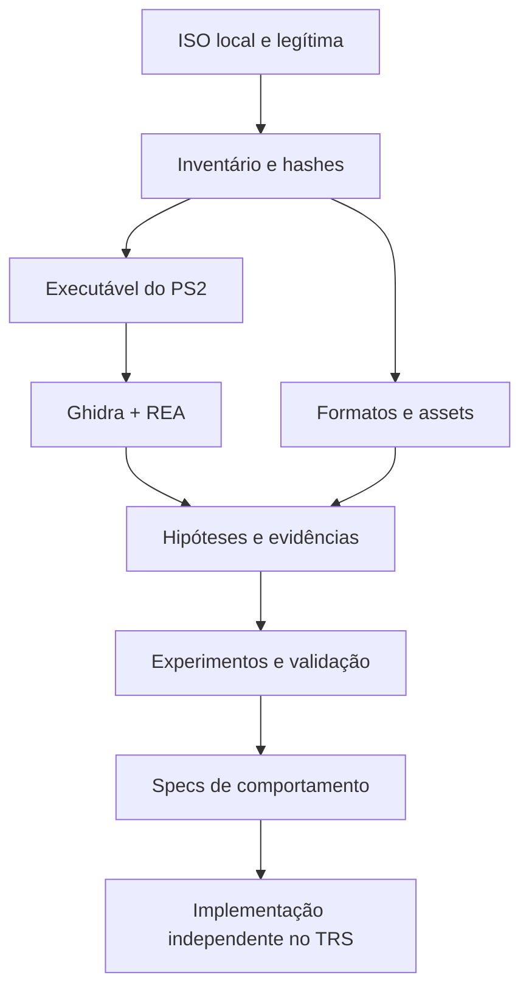

# ⚽ Bomba Patch REA

<p align="center">
  <strong>Reverse engineering de futebol no PlayStation 2 — uma função por vez.</strong><br>
  Um laboratório independente para estudar gameplay, física e animações e documentar implementações equivalentes para a web.
</p>

<p align="center">
  
  
  
</p>

<p align="center">
  
  
  
  
</p>

> [!IMPORTANT]
> **Este repositório não contém jogos, ISOs, BIOS, código proprietário ou assets comerciais.**
> É um projeto independente de pesquisa e documentação; não possui afiliação com a equipe Bomba Patch, a Konami ou a Sony.

## 🎯 Missão

Entender tecnicamente como jogos de futebol para PS2 se comportam e transformar as descobertas **comprovadas** em especificações para implementações próprias no **TRS (Traficas Revolution Soccer)**, um jogo de futebol para navegador.

O objetivo não é portar um executável do PS2 ou publicar conteúdo extraído: é pesquisar, comparar e reconstruir comportamentos de forma independente.

| Prioridade | Área de estudo | Perguntas principais |
| :-- | :-- | :-- |
| **P0** | Reconhecimento | Qual é o jogo-base? Como os arquivos estão organizados? |
| **P1** | Movimentação | Como funcionam aceleração, inércia, rotação e mudança de direção? |
| **P2** | Física da bola | Como são calculados chutes, passes, trajetórias, atrito e colisões? |
| **P3** | Animações e 3D | Como se relacionam esqueletos, estados, transições e modelos? |
| **P4** | IA | Como os jogadores se posicionam e decidem suas ações? |

## 🧰 Stack de investigação

| Ferramenta | Papel |
| :-- | :-- |
| [xorriso](https://www.gnu.org/software/xorriso/) | Inspecionar e extrair sistemas de arquivos ISO 9660 |
| [Binwalk](https://github.com/ReFirmLabs/binwalk) | Identificar assinaturas, dados embutidos e possíveis compressões |
| [Ghidra](https://github.com/NationalSecurityAgency/ghidra) | Análise estática, desassemblagem e decompilação headless |
| [Emotion Engine Reloaded](https://github.com/chaoticgd/ghidra-emotionengine-reloaded) | Suporte às instruções especiais do Emotion Engine |
| [REA](https://github.com/morluto/rea) | Investigações guiadas por agentes e coleta de evidências |
| [PCSX2](https://pcsx2.net/) | Verificação dinâmica de hipóteses, quando necessária |

Arquitetura-alvo: **MIPS R5900 / Emotion Engine**. O identificador da linguagem no plugin Ghidra é **`r5900:LE:32:default`** (confirme no arquivo `emotionengine.ldefs` da sua instalação).

## 🔎 Fluxo de pesquisa



## 🚀 Início rápido no Omarchy

Dependências básicas (Arch Linux):

```bash
sudo pacman -S --needed ghidra binwalk libisoburn binutils file 7zip unzip jq ripgrep
npm install --global rea-agents
rea setup
```

O suporte ao PS2 exige a extensão **Emotion Engine Reloaded**, compatível com a versão instalada do Ghidra. Verifique a arquitetura antes de iniciar uma análise.

Coloque sua imagem de jogo, obtida legalmente, em **`work/iso/`**, que é ignorado pelo Git. Em seguida:

```bash
mkdir -p work/iso work/extracted work/ghidra-projects
xorriso -osirrox on -indev work/iso/game.iso -extract / work/extracted
rg -n 'BOOT2' work/extracted/SYSTEM.CNF
```

O arquivo `SYSTEM.CNF` normalmente aponta para o executável do jogo. **Identifique e valide esse arquivo antes de importar no Ghidra**; nem todo arquivo `.bin` é código, modelo ou textura.

Para um executável já identificado:

```bash
ghidra-analyzeHeadless work/ghidra-projects PS2Research \
  -import /caminho/real/do/executavel \
  -processor r5900:LE:32:default \
  -analysisTimeoutPerFile 900
```

Os comandos são exemplos: adapte os caminhos à sua ISO e não presuma que o formato ou a versão-base já estejam identificados.

## 🌙 Investigações noturnas

O laboratório foi pensado para sessões longas com agentes, incluindo execuções de até **8 horas**:

- Trabalhar em etapas pequenas e verificáveis, salvando checkpoints.
- Registrar fonte, endereço/offset, hash e grau de confiança de cada descoberta.
- Impor timeouts e limites de concorrência; evitar loops sem progresso.
- Continuar por caminhos seguros quando uma hipótese falhar.
- Produzir um resumo para revisão humana antes de qualquer implementação no TRS.

As regras operacionais detalhadas estão em **[AGENTS.md](AGENTS.md)**.

## 🗂️ Organização

```text
.
├── README.md        # Apresentação e fluxo
├── AGENTS.md        # Instruções para agentes
├── .gitignore       # Proteção contra publicação de ISOs/dumps
├── research/         # Relatórios textuais futuros, revisados
└── work/             # ISOs, extrações e projetos locais (ignorado)
```

Os diretórios `research/` e `work/` são **planejados** e podem ser criados conforme a investigação evoluir.

## ⚖️ Limites e atribuição

Este projeto é voltado a pesquisa, interoperabilidade e documentação. Direitos sobre Bomba Patch, Pro Evolution Soccer/Winning Eleven, PlayStation e seus respectivos conteúdos pertencem a seus titulares. **Não faça upload de imagens de disco, BIOS, binários, modelos, texturas, áudio ou animações extraídos.**

**Feito para aprender como a bola rola — e construir nossa própria física.** ⚽
